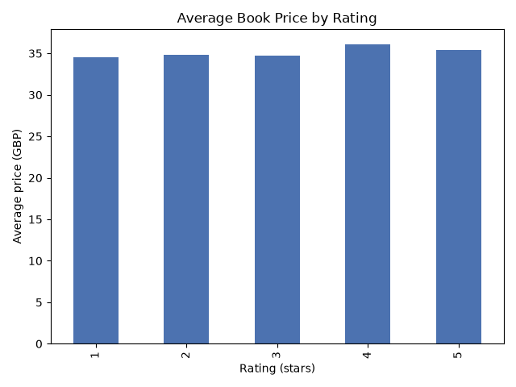

# Book Price Scraper and Cleaner

A Python tool that scrapes 1,000 books from books.toscrape.com,
cleans the data with pandas, and generates a price analysis chart.

## What it does
- Scrapes title, price, rating and stock status from all 50 pages
- Cleans prices (removes currency symbols), converts star ratings to numbers, removes duplicates
- Saves a clean CSV and a chart (average price by rating)

## Tools used
Python, Requests, BeautifulSoup, Pandas, Matplotlib

## How to run
pip install requests beautifulsoup4 pandas matplotlib
python book_scraper.py

## Sample output

Total books: 1000 | Average price: 35.07

## Author
SUNIL KUMAR S | [GitHub](https://github.com/sunilkumarsunil12930-alt)